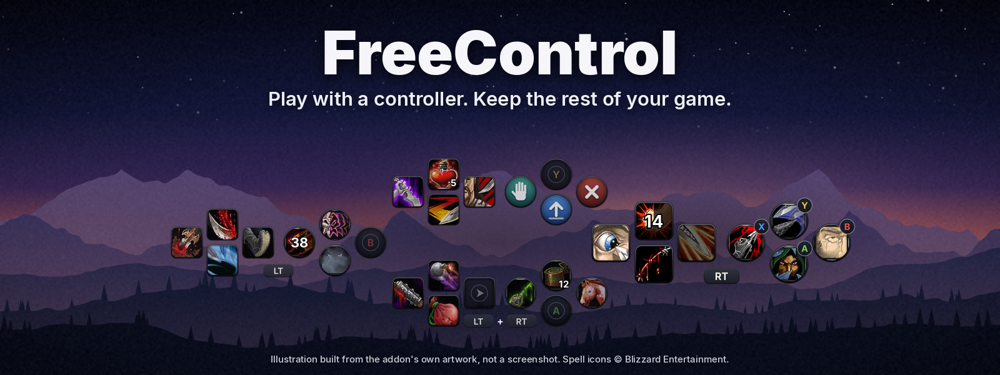
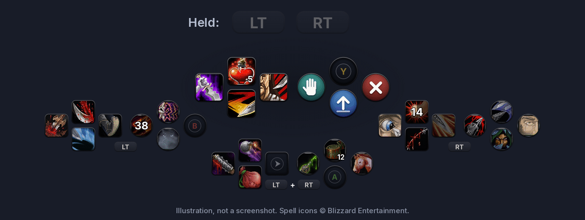
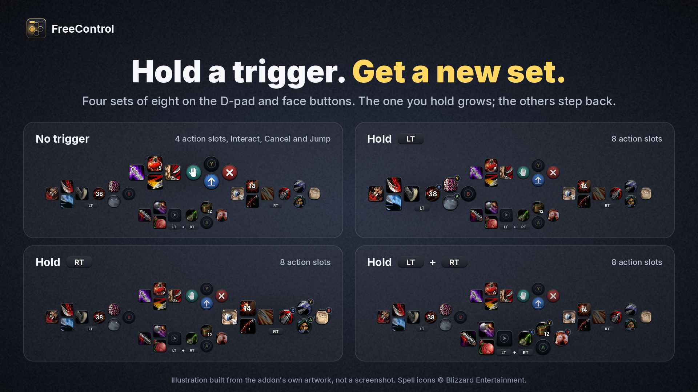
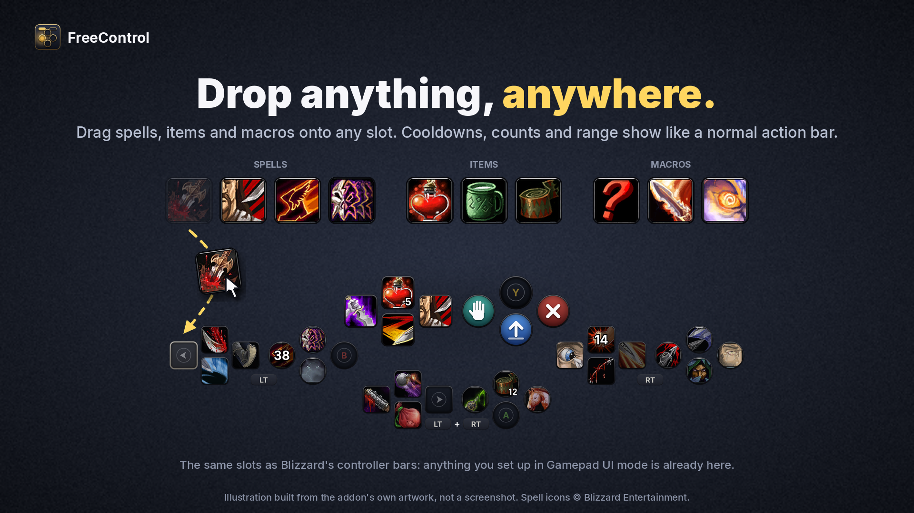
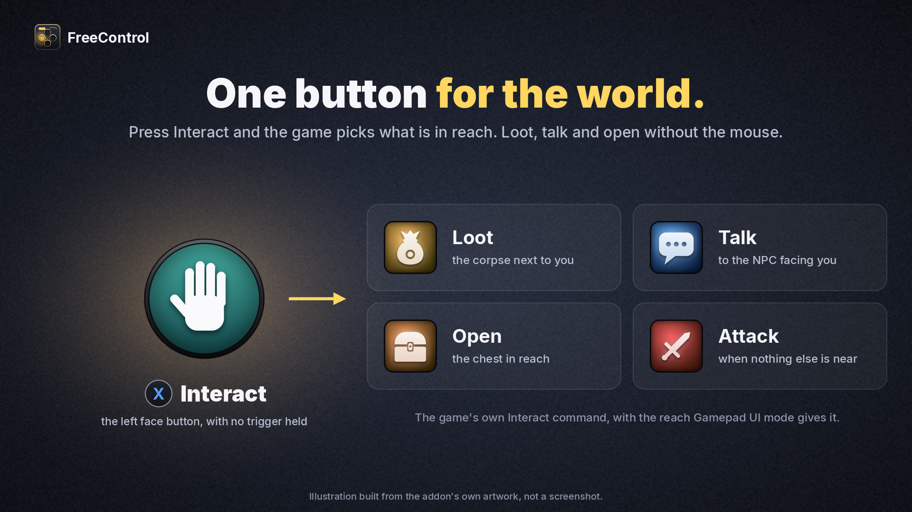
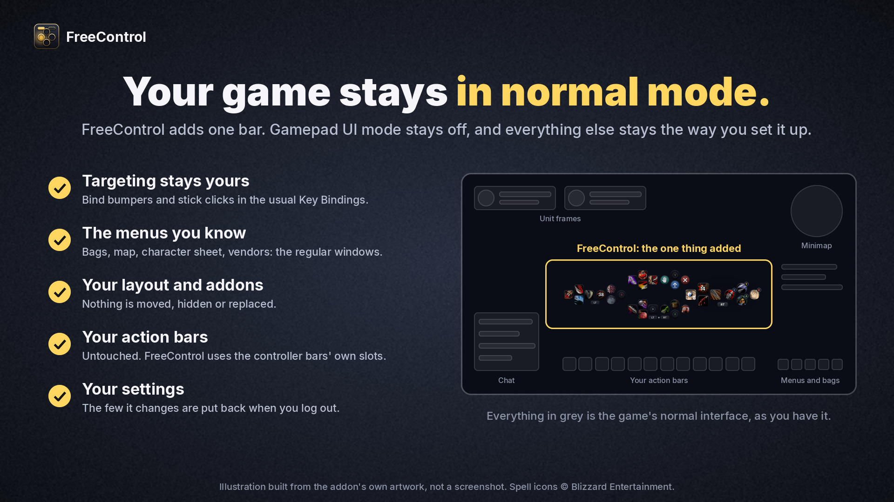
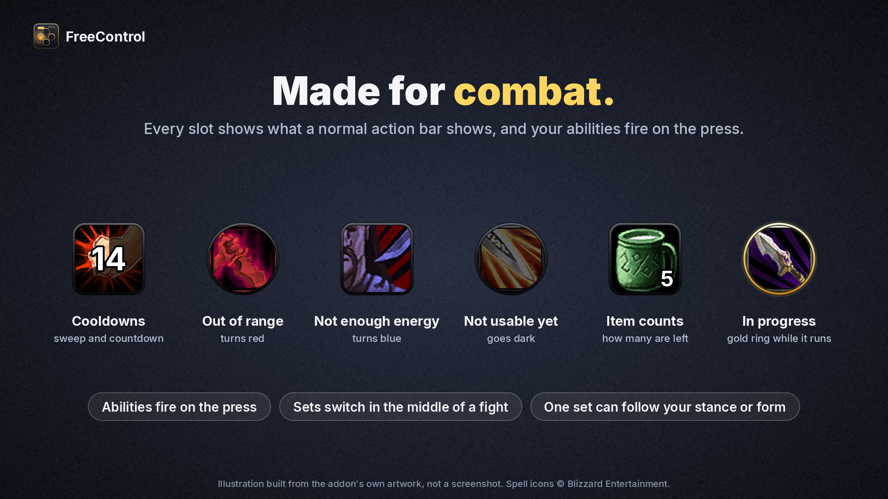
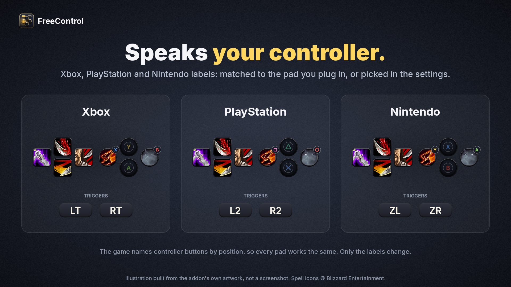

  

<h1 align="center">FreeControl</h1>

  <b>The controller cross hotbar for World of Warcraft: Forever, in the normal interface.</b> 
  Hold LT, RT or both for 32 buttons. Gamepad UI mode stays off, and your targeting, menus and layout stay yours.

  
  
  
  

  <a href="#install">Install</a> ·
  <a href="#how-it-plays">How it plays</a> ·
  <a href="#settings">Settings</a> ·
  <a href="#how-it-compares">How it compares</a> ·
  <a href="#developing">Developing</a>

---

Forever's built-in Gamepad UI has a great idea at its heart: hold a trigger, and the D-pad and face
buttons become a new set of abilities. It is the layout console MMO players know from Final Fantasy
XIV. Switching that mode on also takes over your targeting, your menus and your interface layout.

**FreeControl is that hotbar on its own.** The game stays in its normal mode, and you pick up the
controller and play.

  

## What you get

<table>
  <tr>
    <td width="50%" valign="top">
      
      <b>32 buttons under your thumbs.</b> Four sets of eight on the D-pad and face buttons: no
      trigger, LT, RT, and both. The set you are holding grows, and the others step back.
    </td>
    <td width="50%" valign="top">
      
      <b>Drop anything, anywhere.</b> Spells, items and macros go on any slot by drag and drop, and
      show cooldowns with a countdown, counts and range like a normal action bar.
    </td>
  </tr>
  <tr>
    <td width="50%" valign="top">
      
      <b>One button for the world.</b> Interact loots the corpse next to you, talks to the NPC in
      front of you, opens the chest, and attacks your target when nothing else is in reach.
    </td>
    <td width="50%" valign="top">
      
      <b>Everything else stays yours.</b> Bumpers and stick clicks are free for whatever targeting
      you like, the menus are the ones you know, and your regular action bars are never touched.
    </td>
  </tr>
  <tr>
    <td width="50%" valign="top">
      
      <b>Made for combat.</b> Sets switch and abilities fire on the press, the button sinks under
      your thumb, and its cooldown starts at once. One set can follow your stance or form.
    </td>
    <td width="50%" valign="top">
      
      <b>Speaks your controller.</b> Xbox, PlayStation and Nintendo labels, matched to the pad you
      plug in or picked in the settings.
    </td>
  </tr>
</table>

The pictures on this page are illustrations, not screenshots, drawn by <code>tools/make_listing.py</code>
from the addon's own textures and layout numbers. The spell icons in them are Blizzard's.

## Install

**By hand**

1. Download the zip from the [latest release](https://github.com/skytruax/FreeControl/releases/latest).
2. Unzip it into `World of Warcraft\_forever_\Interface\AddOns\`, so that you end up with
   `...\AddOns\FreeControl\FreeControl.toc`.
3. Enable FreeControl on the character screen.

**With the CurseForge app:** the listing is on its way. Once it is up, FreeControl installs and
updates there like any other addon.

Leave **Options > Gamepad > Enable Gamepad UI** off. FreeControl stands down while that mode is on,
because Blizzard's bar would be bound to the same buttons.

## How it plays

| Hold | You get |
| --- | --- |
| nothing | D-pad: four action slots. X: Interact. B: Cancel / game menu. A: Jump. Y: left to your own key binding. |
| LT | eight action slots (left set) |
| RT | eight action slots (right set) |
| LT + RT | eight action slots (bottom set) |

- **Filling slots:** drag spells, items and macros from the spellbook or bags onto a slot. As on
  the regular action bars, dragging one *off* a slot needs Shift while the action bars are locked.
- **Same slots as the Gamepad UI:** the slots are the ones Blizzard's controller bars use, which
  are separate from your normal action bars. Anything you already set up in Gamepad UI mode is
  there when you log in, and nothing on your regular bars is touched.
- **Interact:** X runs the game's Interact command with "Enable Interact Key" behaviour switched
  on, so it loots the corpse next to you, talks to the NPC in front of you or opens the chest, and
  attacks your target when there is nothing to interact with.
- **Targeting and everything else:** bind the bumpers, stick clicks and Y to whatever you like in
  **Options > Key Bindings**; controller buttons can be bound there like keys.
- **Mouse cursor with the stick:** bind *Controller mouse cursor on / off* (Key Bindings >
  FreeControl) or assign it to a face button, to steer the mouse with the stick when a menu
  needs it. This is the client's own stick cursor.
- **Changing the no-trigger buttons:** click one on the bar, or use the settings page. Each can be
  an action slot, a command (Jump, Interact, Cancel, Target nearest enemy or friend, Auto-run,
  World map, Bags, ...) or left to your own key binding.

<b>Three game defaults worth knowing when you set up the rest of your buttons</b>

- **While the stick cursor is out, RT is the left mouse button and RB the right** (the game's
  `GamePadCursorLeftClick` / `GamePadCursorRightClick`). The cursor comes out by itself for menus
  and goes away when you move, so RT clicks in a menu and selects the right set in play.
  `/fc status` mentions it. To keep RT for the hotbar always, move the click elsewhere, for
  example `/console GamePadCursorLeftClick PADLSTICK`.
- **LB stands in for Ctrl out of the box** (`GamePadEmulateCtrl`). That lets you bind Ctrl
  combinations such as LB + D-pad in Key Bindings, but a button used that way only fires its own
  binding on a quick tap. To use LB as an ordinary button: `/console GamePadEmulateCtrl none`.
- **LT stands in for Shift out of the box.** FreeControl switches that off for the buttons it
  uses while it is active, because a trigger used that way would not register as held.

## Settings

`/fc` opens the page (also under **Options > AddOns > FreeControl**).

| Command | |
| --- | --- |
| `/fc on`, `/fc off` | Switch FreeControl on or off. Off hands every button back to your own bindings. |
| `/fc unlock`, `/fc lock` | Show or hide the handle for dragging the bar. |
| `/fc scale 1.2` | Size of the bar (0.5 to 2). |
| `/fc reset` | Put the bar back where it started. |
| `/fc page 2` | Show another of Blizzard's three controller-bar pages. |
| `/fc slots bars` | Use the regular Left / Bottom Left / Bottom Right / Right action bar slots instead (`gamepad` to go back). |
| `/fc numbers off` | Hide the countdown numbers on slots that are on cooldown (`on` to show them again). |
| `/fc key lt PADLSHOULDER` | Use another button as a trigger (`lt`, `rt`) or for a slot (`1`-`8`). Keyboard keys work too, for Steam Input layouts that send keys. |
| `/fc status` | What FreeControl sees: controller, slots, keys, and anything that would get in the way. Include this in bug reports. |

Other settings on the page: how much the held set grows, how far the others fade, button labels
(Xbox, PlayStation, Nintendo, or matched to your controller), cooldown numbers, and which set swaps
with your stance or form (it follows **Options > Gamepad > Stance bar** unless you choose otherwise).

## What it changes, and puts back

While active, FreeControl sets a few console variables and restores your own values at logout or
when you switch it off:

| Variable | Why |
| --- | --- |
| `GamePadEnable = 1` | Lets the game read the controller. This is controller *input*, not Gamepad UI mode. Forever ships with it on, so this usually changes nothing. |
| `GamePadEmulateShift` / `Ctrl` / `Alt = none` | Only where one of them names a button FreeControl uses (by default: LT as Shift). |
| `SoftTargetInteract = 3` | The Interact command picks nearby things by itself (Options > Controls > Enable Interact Key). |
| `SoftTargetInteractArc = 1`, `SoftTargetInteractRange = 20`, `SoftTargetIconGameObject = 1` | The reach Gamepad UI mode uses for Interact. |

The first and the Interact ones have checkboxes on the settings page. FreeControl binds the D-pad,
face buttons and triggers with *override* bindings, which sit on top of your saved key bindings
without changing them.

## How it compares

- **Blizzard's Gamepad UI mode** is the game's whole controller interface: hotbar, menus,
  targeting and layout together. FreeControl is only the hotbar. It shows the same action slots
  and stands down whenever that mode is on, so you can go back and forth without setting anything
  up twice.
- **[ConsolePort](https://github.com/seblindfors/ConsolePort)** is a complete controller interface
  addon, with its own bars, cursor, menus and targeting tools. If you want the whole game built
  around the pad, that is the one to look at. FreeControl is for players who want the stock
  interface plus a cross hotbar and nothing more. The two have not been tried together, and both
  bind the controller's buttons, so run one at a time.

## Known limits

- Spell flyouts (a slot holding a group of spells) open below the button and need the mouse to pick
  from. Put the individual spells on the bar instead.
- No vehicle or possess bar yet: use the game's own bar for those.
- Triggers are hold-to-select; there is no tap-to-toggle.
- Hold-to-cast ("press and hold casting") is a client feature reserved for Blizzard's own bars.

Found something else? [Open an issue](https://github.com/skytruax/FreeControl/issues) and paste
what `/fc status` prints.

## Developing

The addon is the [FreeControl/](FreeControl/) folder; everything else in the repository is
tooling. `Layout.lua` holds the fixed facts (sets, geometry, which action slot each button shows),
`Buttons.lua` the buttons, `Bars.lua` the frames around them, and `Bindings.lua` the secure header
that rebinds the eight slot keys when a trigger is pressed, which is what lets the sets switch in
combat. Each file's header comment explains its part.

Two things keep the bar feeling immediate, both taken from Blizzard's own controller buttons: the
keys always act on the press (`useOnKeyDown`), and every slot is registered with the client
(`C_ActionBar.RegisterActionUIButton`), which then starts the button's cooldown itself the moment
the action is used instead of leaving it to an event.

    python3 tools/make_art.py        # redraw FreeControl/Art/*.tga      (Pillow, numpy)
    python3 tools/preview.py         # docs/preview.png: the bar as the addon lays it out
    python3 tools/make_listing.py    # the README and CurseForge pictures (uses the Inter font if installed)

The pictures show a Rogue's spell icons. `tools/game_icons.py` downloads those from a public mirror
of the game's interface art into a git-ignored folder the first time they are needed; add
`--placeholders` to draw stand-ins instead and download nothing.

There are two test suites, and neither needs the game. The addon has also been played in the
Forever 1.60.1 client.

**Mock client** (fast, 50 scenarios, runs on every push):

    pip install lupa
    python3 tools/tests/run.py       # add --globals to list every client API the addon touches

It loads the addon into Lua 5.1 against `tools/tests/wowmock.lua`, a strict stand-in for the
client set to a fresh Forever install's defaults: protected frames refuse protected calls in
combat, secure snippets run in a restricted environment, a button standing in for Shift does not
report being held, and key presses travel through override bindings to button clicks. It is a
model, so a pass shows the addon is consistent with that model, not that the game agrees.

**Simulator** (Blizzard's real interface code, 21 tests, about six seconds):

    tools/sim/lab/build-image.sh     # once: fetches the simulator (about 180 MB) and builds its image
    tools/sim/run.sh

What the simulator run covers, and what it cannot

This loads FreeControl next to all 272 of Blizzard's Forever interface addons (build
1.60.1.70707) in [wow-ui-sim](https://github.com/Osso/wow-ui-sim), inside throw-away Docker
containers with no network. The secure templates, the restricted environment, the state drivers
and the settings panel are Blizzard's own Lua there, and the simulator models combat lockdown and
taint, so it checks things the mock cannot: that the buttons really end up with Blizzard's secure
click handler, that the trigger snippets are accepted and can rebind keys in combat, that a key
press reaches `UseAction` untainted, and that nothing is refused along the way. It also compares
every API, console variable and event the addon names against the Forever client's own lists.
`docs/sim-screenshot.png` is the bar as that run draws it; the simulator has no game art, so
filled slots are blank there.

What it cannot show: it implements about half of the client's API, has no real key or controller
input (the tests click the bound button from a secure call stack instead), has no controller-slot
validity check (so FreeControl falls back to the regular bar slots there unless a test stands in
for it), and never evaluates stance conditions as true. `tools/sim/lab/run-sim.sh --help` lists
its options; `tools/sim/tests/` holds the tests and the screenshot scenario.

[UIForever](https://uiforever.com/) is a hosted alternative: a browser simulator for Forever that
you drop an AddOns folder into. Its site says the files stay in the browser; it was not tried here.

**Releasing:** pushing a tag such as `v1.0.1` runs `.github/workflows/release.yml`. The
[BigWigs packager](https://github.com/BigWigsMods/packager) builds the zip, attaches it to a
GitHub release with `CHANGELOG.md` as the notes, and uploads it to CurseForge once the project id
is in `FreeControl.toc`. The listing text, form fields and pictures live in [curseforge/](curseforge/).

## Licence and credits

FreeControl is released under the [MIT licence](LICENSE). One file is the exception:
`tools/sim/lab/image/Dockerfile` is adapted from [wow-ui-sim](https://github.com/Osso/wow-ui-sim)
and stays under the GPL 3.0, whose text sits next to it. It is test tooling and is not part of the
addon you install.

The addon's artwork is drawn by the scripts in `tools/`, and the addon ships no Blizzard art. The
spell icons that appear in the pictures are Blizzard Entertainment's, shown the way any screenshot
of the game shows them; they are not part of the addon and are not covered by the MIT licence.
World of Warcraft is a trademark of Blizzard Entertainment. FreeControl is a fan-made addon and is
not affiliated with or endorsed by Blizzard.
