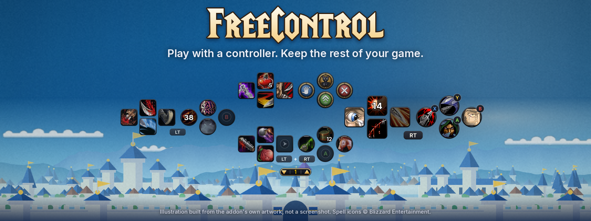
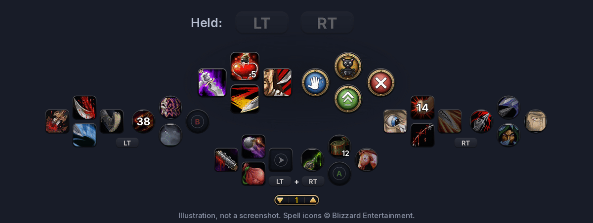
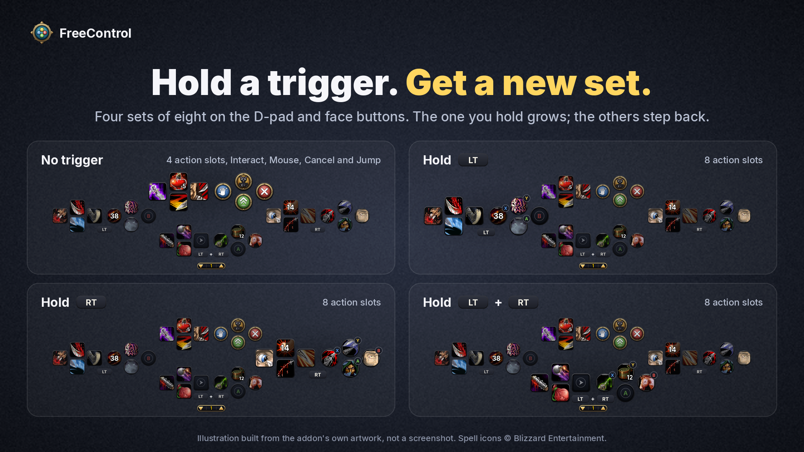
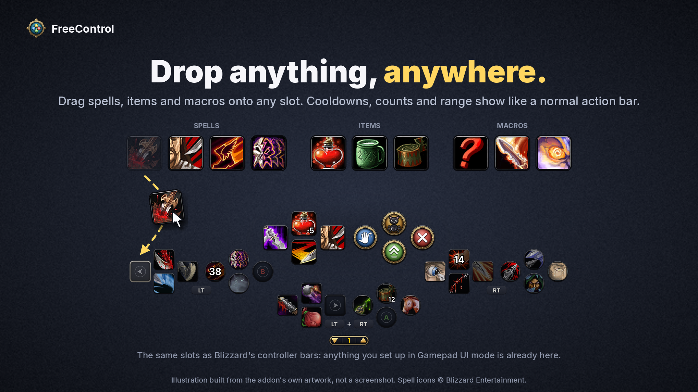
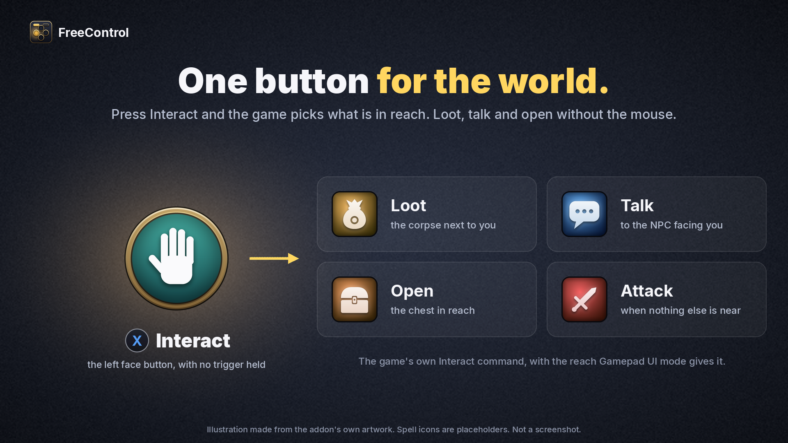
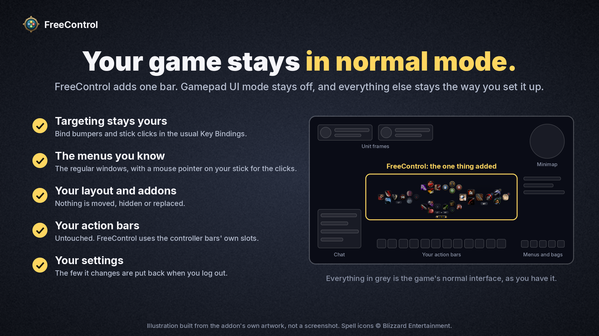
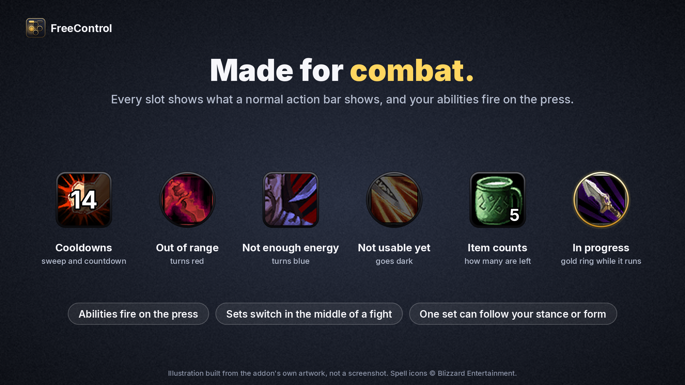
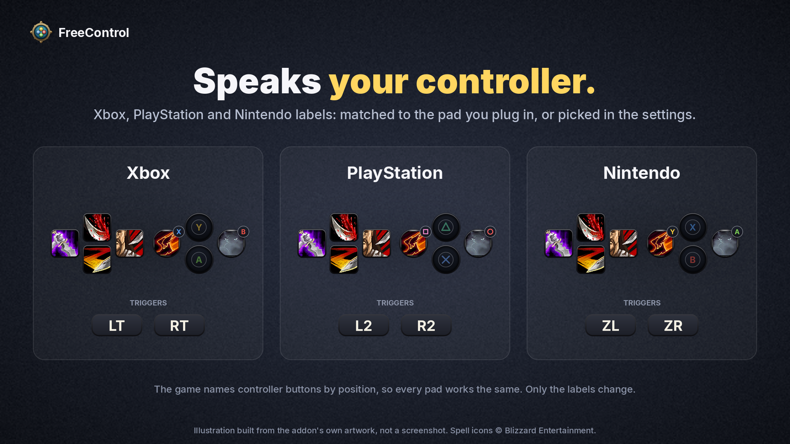
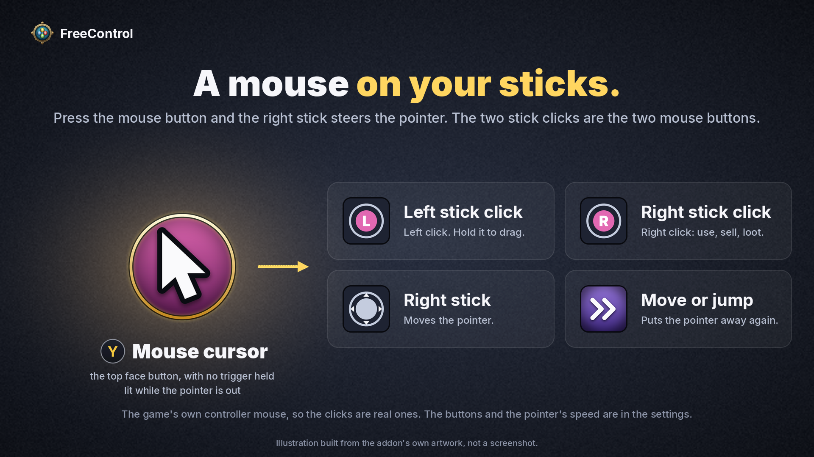
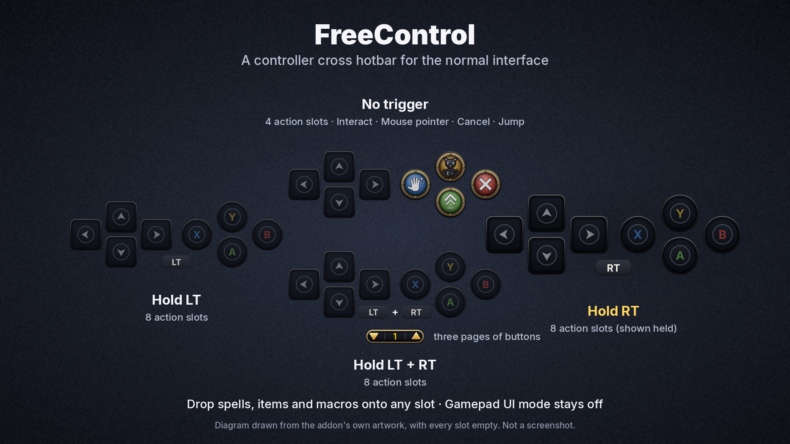

  

<h1 align="center">FreeControl</h1>

  <b>The controller cross hotbar for World of Warcraft: Forever, in the normal interface.</b> 
  Hold LT, RT or both for 32 buttons. Gamepad UI mode stays off, and your targeting, menus and layout stay yours.

  
  
  
  
  

  <a href="#install">Install</a> ·
  <a href="#how-it-plays">How it plays</a> ·
  <a href="#settings">Settings</a> ·
  <a href="#how-it-compares">How it compares</a> ·
  <a href="#developing">Developing</a>

---

Forever's built-in Gamepad UI has a great idea at its heart: hold a trigger, and the D-pad and face
buttons become a new set of abilities. It is the layout console MMO players know from Final Fantasy
XIV. Switching that mode on also takes over your targeting, your menus and your interface layout.

**FreeControl is that hotbar on its own.** The game stays in its normal mode, and you pick up the
controller and play.

  

## What you get

<table>
  <tr>
    <td width="50%" valign="top">
      
      <b>32 buttons under your thumbs.</b> Four sets of eight on the D-pad and face buttons: no
      trigger, LT, RT, and both. The set you are holding grows, and the others step back.
    </td>
    <td width="50%" valign="top">
      
      <b>Drop anything, anywhere.</b> Spells, items and macros go on any slot by drag and drop, and
      show cooldowns with a countdown, counts and range like a normal action bar.
    </td>
  </tr>
  <tr>
    <td width="50%" valign="top">
      
      <b>One button for the world.</b> Interact loots the corpse next to you, talks to the NPC in
      front of you, opens the chest, and attacks your target when nothing else is in reach.
    </td>
    <td width="50%" valign="top">
      
      <b>Everything else stays yours.</b> Bumpers and stick clicks are free for whatever targeting
      you like, the menus are the ones you know, and your action bars are not rearranged.
    </td>
  </tr>
  <tr>
    <td width="50%" valign="top">
      
      <b>Made for combat.</b> Sets switch in the middle of a fight, the button sinks under your
      thumb, and its cooldown shows the moment it starts. The bar follows your stance or form: one
      set for most classes, two sets and the D-pad for a Druid.
    </td>
    <td width="50%" valign="top">
      
      <b>Speaks your controller.</b> Xbox, PlayStation and Nintendo labels, matched to the pad you
      plug in or picked in the settings.
    </td>
  </tr>
  <tr>
    <td width="50%" valign="top">
      
      <b>A mouse on your sticks.</b> Press Y and the right stick steers the pointer. Click the left
      stick to left-click and drag, the right stick to right-click. Move or jump and it is gone.
    </td>
    <td width="50%" valign="top">
      
      <b>Yours to rearrange.</b> Every no-trigger button can be an action slot, a command or your
      own key binding, and the settings page covers the rest.
    </td>
  </tr>
</table>

The pictures on this page are illustrations, not screenshots, drawn by <code>tools/make_listing.py</code>
from the addon's own textures and layout numbers. The spell icons in them are Blizzard's, and the
title lettering is LifeCraft, a typeface by Eliot Truelove.

## Install

**With the CurseForge app:** search for FreeControl, or start from its
[CurseForge page](https://www.curseforge.com/projects/1800965). It installs and updates there like
any other addon.

**By hand**

1. Download the zip from the [latest release](https://github.com/skytruax/FreeControl/releases/latest).
2. Unzip it into `World of Warcraft\_forever_\Interface\AddOns\`, so that you end up with
   `...\AddOns\FreeControl\FreeControl.toc`.
3. Enable FreeControl on the character screen.

Leave **Options > Gamepad > Enable Gamepad UI** off. FreeControl stands down while that mode is on,
because Blizzard's bar would be bound to the same buttons.

## How it plays

| Hold | You get |
| --- | --- |
| nothing | D-pad: four action slots. X: Interact. Y: mouse pointer on / off. B: Cancel / game menu. A: Jump. |
| LT | eight action slots (left set) |
| RT | eight action slots (right set) |
| LT + RT | eight action slots (bottom set) |

- **Filling slots:** drag spells, items and macros from the spellbook or bags onto a slot. As on
  the regular action bars, dragging one *off* a slot needs Shift while the action bars are locked.
- **Pages:** the bar has three pages, the Gamepad UI's three, each with its own buttons. The small
  plate under the LT + RT set shows which one is up, and the arrow at each end of it turns the
  page, in a fight too. To turn it from the controller, give two buttons the job: on the *Other
  buttons* page of the settings, or in **Options > Key Bindings** under FreeControl. The bumpers
  are the obvious pair. The middle of the bar is left empty for whatever you keep there.
  Both parts are optional. Untick *Page selector on the bar* on the settings page and the plate
  is gone while your buttons still turn the page; untick *Pages* and the bar stays on one page,
  the one picked under *Page*.
- **Same slots as the Gamepad UI:** the slots are the ones Blizzard's controller bars use, which
  are separate from your normal action bars. Anything you already set up in Gamepad UI mode is
  there when you log in, and your regular bars are left alone (the one exception is under
  *Stances and forms* below).
- **Interact:** X runs the game's Interact command with "Enable Interact Key" behaviour switched
  on, so it loots the corpse next to you, talks to the NPC in front of you or opens the chest, and
  attacks your target when there is nothing to interact with.
- **Mouse mode:** press Y, the button that wears FreeControl's mascot (a little black dog that is
  half chihuahua, half beetle), and the right stick steers the mouse pointer. Click the left stick for
  the left mouse button (hold it to drag a spell onto the bar) and the right stick for the right
  one. Press Y again and the pointer goes away; the game also puts it away when you jump. The Y
  button on the bar is lit while it is out. FreeControl binds Y itself, the way it binds
  Interact: there is nothing to set up in the Key Bindings screen. Both click buttons and the
  pointer's speed can be changed on the *Mouse mode* page of the settings. To have Y do something
  else, click it on the bar; any other no-trigger button can be the mouse button instead (choose
  *Mouse pointer on / off*).
- **No mouse mode:** untick *Mouse mode* on the settings page (`/fc mouse off`) and the mouse
  button is an ordinary action slot instead: drop a spell, an item or a macro on it, a different
  one on each page if you like. No button of FreeControl's brings the pointer out then. The game
  still brings its own out when a window needs one, and your two click buttons still click.
- **Procs:** a button glows gold while its spell has procced. FreeControl follows the game's own
  proc signal, the one the regular action bars use. Overpower, Victory Rush, Riposte,
  Counterattack and Mongoose Bite also glow for the moment they can be used, and Ambush when it
  can be used outside stealth (those go by their English names).
- **Spell ranks:** learn a new rank and the copy on the bar moves up to it, once you are out of
  combat. The game does this for its regular action bars but not for the controller's slots
  outside Gamepad UI mode. A lower rank you put on a slot yourself is left alone.
- **Stances and forms:** buttons change to different slots when you change stance or form, so
  each one has its own abilities. For most classes that is one set (the right-trigger set,
  unless **Options > Gamepad > Stance bar** names another). A Druid cannot use a single caster
  spell in Cat or Bear form, so for a Druid the right set, the left set and the D-pad all
  change, and the both-triggers set and the face buttons stay the same in every form: that is
  where a mount or a trinket goes. The left set and the D-pad show the slots of the game's own
  action bar for that form, so a bar you already set up there is waiting for you. *Stance sets*
  on the settings page offers the same to any class.
  They change on one page only, as the game's own bars do: page 1, unless the Gamepad options
  put the stance bar on another. The other pages are the same in every stance or form.
  A stance or form (a Druid's forms, Stealth, a Warrior's stances) that you put on a button that
  changes shows on that button in every stance that has nothing of its own there, whichever
  stance you were in when you put it there, so the way back is never lost. Drop something on the
  button while you are in a stance to give that stance its own.
- **A button of its own for a stance:** any no-trigger button, bumper or paddle can be given
  *Stance or form: Bear Form*, *Battle Stance* and so on: click the button on the bar, or use the
  *Other buttons* page. It runs the game's own command for its stance bar, wears the stance's
  icon, is lit while you are in it, and is the same button on every page and in every stance.
  The D-pad with no trigger held makes a good stance switcher for a Druid or a Warrior. A
  Paladin's auras are on the game's stance bar as well, so they work the same way.
- **Your other buttons:** the bumpers, stick clicks, Start, Back and paddles are ordinary buttons.
  FreeControl does not use them, and each does whatever it is bound to, like a key on the
  keyboard. The *Other buttons* page of the settings (`/fc buttons`) lists them with what each
  one does and offers the common jobs in a menu; **Options > Key Bindings** does the rest. The
  stick clicks keep their jobs except while the mouse pointer is out.
- **Changing the no-trigger buttons:** click one on the bar, or use the settings page. Each can be
  an action slot, a command (Jump, Interact, Cancel, Target nearest enemy or friend, Auto-run,
  World map, Bags, one of your stances or forms, ...) or left to your own key binding.

<b>Three game defaults worth knowing when you set up the rest of your buttons</b>

- **The game's own mouse-click buttons are RT and RB** (`GamePadCursorLeftClick` and
  `GamePadCursorRightClick`). RT is a hotbar trigger, so while it is active FreeControl points
  those two settings at the stick clicks instead, and puts yours back when you log out. To keep
  the game's own choice for one of them, pick *Leave to the game* on the settings page.
- **LB stands in for Ctrl out of the box** (`GamePadEmulateCtrl`). That lets you bind Ctrl
  combinations such as LB + D-pad in Key Bindings, but a button used that way only fires its own
  binding on a quick tap, which is why LB can seem to do nothing. Give LB a job on the *Other
  buttons* page, or bind it to one of FreeControl's page arrows, and FreeControl makes it an
  ordinary button while it is active.
- **LT stands in for Shift out of the box.** FreeControl switches that off for the buttons it
  uses while it is active, because a trigger used that way would not register as held.

## Settings

`/fc` opens the page (also under **Options > AddOns > FreeControl**).

| Command | |
| --- | --- |
| `/fc on`, `/fc off` | Switch FreeControl on or off. Off hands every button back to your own bindings. |
| `/fc unlock`, `/fc lock` | Show or hide the handle for dragging the bar. |
| `/fc scale 1.2` | Size of the bar (0.5 to 2). |
| `/fc reset` | Put the bar back where it started. |
| `/fc page 2` | Show another of the three pages. The arrows under the LT + RT set do the same. |
| `/fc pages off` | Keep the bar on one page, the one `/fc page` picks; nothing turns it (`on` to bring the pages back). |
| `/fc pager off` | Take the page selector off the bar. A button you gave a page arrow still turns the page (`on` to show it again). |
| `/fc buttons` | Open the Other buttons page: jobs for the bumpers, stick clicks, Start, Back and paddles. |
| `/fc slots bars` | Use the regular Left / Bottom Left / Bottom Right / Right action bar slots instead (`gamepad` to go back). |
| `/fc numbers off` | Hide the countdown numbers on slots that are on cooldown (`on` to show them again). |
| `/fc glow off` | Stop buttons glowing when a spell procs (`on` to bring it back). |
| `/fc ranks` | Move every spell on the bar up to its newest rank now. `/fc ranks off` stops FreeControl doing it by itself when you learn one (`on` to bring it back). |
| `/fc stance all` | What changes with your stance or form: `auto`, `none`, `lt`, `rt`, `both`, `ltrt` (both trigger sets) or `all` (both and the D-pad). |
| `/fc mouse` | Bring the mouse pointer out or put it away, like the Y button. |
| `/fc mouse off` | Switch mouse mode off: its button becomes an action slot (`on` to switch it back on). |
| `/fc click left PADLSHOULDER` | Use another button as the left (`left`) or right (`right`) mouse click while the pointer is out. `game` leaves that click to the game's own setting. |
| `/fc pointer 150` | How fast the stick moves the mouse pointer, in percent (50 to 300). |
| `/fc key lt PADLSHOULDER` | Use another button as a trigger (`lt`, `rt`) or for a slot (`1`-`8`). Keyboard keys work too, for Steam Input layouts that send keys. |
| `/fc status` | What FreeControl sees: controller, slots, keys, anything that would get in the way, and any error it ran into. Include this in bug reports. |
| `/fc trace` | Records what the game reports about the next abilities you use, for twenty seconds. Type it again to see the result in a box you can copy from. For reports about cooldowns. |

Other settings on the page: how much the held set grows, how far the others fade, button labels
(Xbox, PlayStation, Nintendo, or matched to your controller), cooldown numbers, whether the bar
has pages and shows its page selector, what changes with your stance or form (*Stance sets*:
automatic unless you choose otherwise, and its tooltip says what that comes to on your
character), and the switch for mouse mode. Two more pages sit under FreeControl: **Mouse mode**,
with the two click buttons and the pointer speed, and **Other buttons**.

## What it changes, and puts back

While active, FreeControl sets a few console variables and restores your own values at logout or
when you switch it off:

| Variable | Why |
| --- | --- |
| `GamePadEnable = 1` | Lets the game read the controller. This is controller *input*, not Gamepad UI mode. Forever ships with it on, so this usually changes nothing. |
| `GamePadEmulateShift` / `Ctrl` / `Alt = none` | Only where one of them names a button FreeControl uses (by default: LT as Shift), a button you gave a job on the Other buttons page, or one you bound to a page arrow (by default LB is Ctrl). |
| `GamePadCursorLeftClick`, `GamePadCursorRightClick` | The two buttons that click while the mouse pointer is out: the stick clicks unless you choose others. Set with mouse mode switched off as well, for the pointer the game brings out by itself. |
| `GamePadCursorCentering = 0` | With it on, the game pins the mouse pointer to the middle of the screen. It is off unless something turned it on. |
| `GamePadCursorSpeedStart`, `...Accel`, `...Max` | Only when you change the pointer speed: all three are scaled together from your own values. |
| `SoftTargetInteract = 3` | The Interact command picks nearby things by itself (Options > Controls > Enable Interact Key). |
| `SoftTargetInteractArc = 1`, `SoftTargetInteractRange = 20`, `SoftTargetIconGameObject = 1` | The reach Gamepad UI mode uses for Interact. |

The first and the Interact ones have checkboxes on the settings page. FreeControl binds the D-pad,
face buttons and triggers with *override* bindings, which sit on top of your saved key bindings
without changing them. A job you pick on the Other buttons page is different: it is one of your
own key bindings, saved by the game as if you had made it in the Key Bindings screen, and it stays
when FreeControl is switched off.

## How it compares

- **Blizzard's Gamepad UI mode** is the game's whole controller interface: hotbar, menus,
  targeting and layout together. FreeControl is only the hotbar. It shows the same action slots
  and stands down whenever that mode is on, so you can go back and forth without setting anything
  up twice.
- **[ConsolePort](https://github.com/seblindfors/ConsolePort)** is a complete controller interface
  addon, with its own bars, cursor, menus and targeting tools. If you want the whole game built
  around the pad, that is the one to look at. FreeControl is for players who want the stock
  interface plus a cross hotbar and nothing more. The two have not been tried together, and both
  bind the controller's buttons, so run one at a time.

## Known limits

- Spell flyouts (a slot holding a group of spells) open below the button and need the mouse
  pointer to pick from. Put the individual spells on the bar instead.
- Mouse mode clicks windows through the game's own controller mouse, which needs a plain button:
  a trigger combination cannot be a click button.
- The game's controller slots have no place for the four face buttons with no trigger held. A
  face button you make an action slot (which is what the mouse button becomes with mouse mode
  off) borrows the LT + RT slot of the same button on the page before: Y on page 1 and LT + RT +
  Y on page 3 are one slot, and so on round. It has its own action on each page, but that action
  also shows on the other button.
- A second changing set and the D-pad keep their stance actions in the slots of the game's own
  action bar for that stance, so what you drop on them in a form also shows on that bar. The
  rest of your regular action bars is never touched.
- With `/fc slots bars` there is one page, and Automatic changes nothing with your stance: pick
  a set under *Stance sets* yourself. One set and the D-pad can change there, not two sets.
- Which bar each form of each class brings up is the game's own data. FreeControl follows what
  the game reports; `/fc status`, typed while in a form, shows it.
- No vehicle or possess bar yet: use the game's own bar for those.
- Triggers are hold-to-select; there is no tap-to-toggle.
- Hold-to-cast ("press and hold casting") is a client feature reserved for Blizzard's own bars.

Found something else? [Open an issue](https://github.com/skytruax/FreeControl/issues) and paste
what `/fc status` prints.

## Developing

The addon is the [FreeControl/](FreeControl/) folder; everything else in the repository is
tooling. `Layout.lua` holds the fixed facts (sets, geometry, which action slot each button shows),
`Buttons.lua` the buttons, `Bars.lua` the frames around them, and `Bindings.lua` the secure header
that rebinds the eight slot keys when a trigger is pressed, which is what lets the sets switch in
combat. Each file's header comment explains its part.

What keeps the bar feeling immediate:

- The keys always act on the press (`useOnKeyDown`), as Blizzard's own controller buttons do.
- Cooldowns are drawn without being read. In combat the game seals a cooldown's start and length
  from addons ("secret values"), and a cooldown frame refuses sealed numbers from addon code with
  an error. So the bar asks only whether a cooldown is running (`isActive`, which is never sealed)
  and hands the frame the game's duration object (`C_ActionBar.GetActionCooldownDuration`,
  `Cooldown:SetCooldownFromDurationObject`). The frame draws the sweep and the countdown itself.
- Cooldowns follow `ACTIONBAR_UPDATE_COOLDOWN`, `SPELL_UPDATE_COOLDOWN` and `BAG_UPDATE_COOLDOWN`.
  Nothing is polled.

Mouse mode ([Mouse.lua](FreeControl/Mouse.lua)) is the game's own stick pointer with a way to
click. The game keeps two things apart: whether a stick steers the pointer (`SetGamePadCursorControl`)
and whether the controller is steering the camera (`SetGamePadFreeLook`), during which the pointer
is hidden. Version 1.2.0 asked for the first without ending the second, and a player pressing the
button in the middle of play saw nothing. The pointer is now brought out by ending camera mode
first, the order ConsolePort uses, and `/fc status` prints what the game says about both, how
often the button was pressed and what came of it.

The game treats a mouse button as two things: a click on a window comes from the two buttons named
by `GamePadCursorLeftClick` and `GamePadCursorRightClick`, and a click on the world goes through
key bindings to the commands the real mouse buttons run. FreeControl sets the first pair and, while
the pointer is out, binds the same buttons to the second, from the secure header so that it works
in a fight. That two-part behaviour is how ConsolePort describes the client to its users. None of
mouse mode can be tried without the game, so treat it as the least proven part of the addon.

A press of the mouse button has two halves for the same reason: a restricted snippet that rebinds
the click buttons, and ordinary code after it that asks the game for the pointer. With mouse mode
switched off neither acts, and both go by one attribute on the header (`fc-mouse-on`) rather than
by the setting, so they cannot disagree while a setting changed in a fight waits for it to end.
The mouse button's role is taken off the bar at the same time (`ns.SetMouseMode`), which is what
makes it a slot.

Spell ranks ([Ranks.lua](FreeControl/Ranks.lua)): the game keeps two sets of action bars, one for
mouse and keyboard and one for the controller, and going by what players see it moves a spell up
to a newly learned rank only in the set that is in use. FreeControl shows the controller's set in
the normal interface, so it does that itself. The spell book says which spells are lower ranks
(`C_SpellBook.IsSpellBookItemLowRank`) and which spell of the same name is the newest; a slot is
refilled the way a hand would do it (`PickupSpellBookItem`, `PlaceAction`, `ClearCursor`), outside
combat and with an empty cursor. A slot is only moved up if it held the newest rank the last time
it was looked at, which is kept per character in the saved settings.

The proc glow ([Buttons.lua](FreeControl/Buttons.lua)) asks what Blizzard's own action buttons ask,
`C_SpellActivationOverlay.IsSpellOverlayed`, on the same two events. The short list of abilities
that only come free for a moment is in `Layout.REACTIVE`.

Pages and stances ([Bindings.lua](FreeControl/Bindings.lua), [Layout.lua](FreeControl/Layout.lua)):
which slot each button shows is decided by the same secure header that rebinds the keys, because
both can change in a fight. `Buttons:Assign` hands it every button's slot on every page and where
each stance keeps its slots; a restricted snippet then sets the buttons' `action` attribute, and
the pictures follow the attribute. Three things run that snippet: a click on a page arrow (a
secure button, so a key bound to it works in combat), a state driver that reports which stance
bar is up (one `[bonusbar:N]` clause per stance), and a settings change. The snippet asks the game
nothing: what it needs to know about a slot's contents (whether a button is to show a stance kept
from another of its slots) is worked out by ordinary code outside combat and handed over as
attributes. A button given a stance for good is not a slot at all: it is bound to the game's own
stance bar command (`SHAPESHIFTBUTTON1` to `10`), like any other command button.

A changing button needs somewhere to keep its action for each stance, and the game has two such
places: the controller stance bars (eight slots per stance, the ones the Gamepad UI shows) and
the twelve slots its regular action bar turns to in that stance (73 to 132). The first changing
set uses the former; a second set and the D-pad use the latter. `/fc status` compares both with
what the game reports for the stance you are in, and says which stance bar the header is
following.

The Other buttons page ([Options.lua](FreeControl/Options.lua)) sets the player's own key bindings
with `SetBinding` and `SaveBindings`, as the Key Bindings screen does. A button the game uses as a
stand-in for Shift, Ctrl or Alt (LB is Ctrl out of the box) is made a plain button by
[CVars.lua](FreeControl/CVars.lua) once it has a job, and only then.

An error while drawing the bar is never silent: it goes to the game's error handler as usual, the
first one is also said in chat, and `/fc status` lists them. The game hides addon errors by
default, which is how the bar went on passing sealed numbers to its sweeps up to version 1.1.1.
[LibActionButton](https://github.com/Nevcairiel/LibActionButton-1.0), the button library behind
Bartender4 and ConsolePort, draws cooldowns from duration objects on this client; reading how it
does that is what pointed to the cause.

    python3 tools/make_art.py        # redraw FreeControl/Art/*.tga      (Pillow, numpy, cairosvg or Inkscape)
    python3 tools/preview.py         # docs/preview.png: the bar as the addon lays it out
    python3 tools/make_listing.py    # the README and CurseForge pictures (uses the Inter font if installed)

The mascot on the mouse button is drawn by hand as an SVG, `tools/art/chihuahua-beetle.svg`;
`make_art.py` sets it into the button's ring, which is what needs cairosvg or Inkscape.

The pictures show a Rogue's spell icons. `tools/game_icons.py` downloads those from a public mirror
of the game's interface art into a git-ignored folder the first time they are needed; add
`--placeholders` to draw stand-ins instead and download nothing.

There are two test suites, and neither needs the game. The addon has also been played in the
Forever 1.60.1 client.

**Mock client** (fast, 257 scenarios, runs on every push):

    pip install lupa
    python3 tools/tests/run.py       # add --globals to list every client API the addon touches

It loads the addon into Lua 5.1 against `tools/tests/wowmock.lua`, a strict stand-in for the
client set to a fresh Forever install's defaults: protected frames refuse protected calls in
combat, secure snippets run in a restricted environment, a button standing in for Shift does not
report being held, key presses travel through override bindings (and, where there is none, the
player's own bindings) to button clicks, in combat cooldown numbers come back sealed and are
refused by cooldown frames, using the controller puts the client in camera mode where the pointer
stays hidden until that is ended, while the stick pointer is out its two click buttons become
mouse clicks, and a font string that was given no text answers nil when asked for it (version
1.5.0 took that answer for a tooltip's title, which the game refuses, as the model's tooltip now
does). State drivers are a port of Blizzard's own. Each class has its stances or forms by
the classic rules, and one scenario walks every class through every stance setting, page and form,
in and out of combat, checking that each button shows and casts the slot the rules give it. It is
a model, so a pass shows the addon is consistent with that model, not that the game agrees.

**Simulator** (Blizzard's real interface code, 48 tests, about fifteen seconds):

    tools/sim/lab/build-image.sh     # once: fetches the simulator (about 180 MB) and builds its image
    tools/sim/run.sh

What the simulator run covers, and what it cannot

This loads FreeControl next to all 272 of Blizzard's Forever interface addons (build
1.60.1.70707) in [wow-ui-sim](https://github.com/Osso/wow-ui-sim), inside throw-away Docker
containers with no network. The secure templates, the restricted environment, the state drivers
and the settings panel are Blizzard's own Lua there, and the simulator models combat lockdown and
taint, so it checks things the mock cannot: that the buttons really end up with Blizzard's secure
click handler, that the trigger, page and stance snippets are accepted and can rebind keys and
move the buttons in combat, that a key press reaches `UseAction` untainted, and that nothing is
refused along the way. It also compares every API, console variable and event the addon names
against the Forever client's own lists.
`docs/sim-screenshot.png` is the bar as that run draws it; the simulator has no game art, so
filled slots are blank there.

What it cannot show: it implements about half of the client's API, does not seal anything in
combat, has no stick pointer of its own (the tests stand in for it), has no real key or controller
input (the tests click the bound button from a secure call stack instead), has no controller-slot
validity check (so FreeControl falls back to the regular bar slots there unless a test stands in
for it), and has no stances or forms. For those the test helper answers `[bonusbar:N]` from
secure code, so Blizzard's state driver and the header's snippets do run for a stance coming up
in a fight; which bar each form of each class brings up is the game's data, and is in neither
suite.
`tools/sim/lab/run-sim.sh --help` lists its options; `tools/sim/tests/` holds the tests and the
screenshot scenario. On a machine that is busy with something else, `SIM_CPUS=13-16 tools/sim/run.sh`
keeps the simulator to the CPUs named.

[UIForever](https://uiforever.com/) is a hosted alternative: a browser simulator for Forever that
you drop an AddOns folder into. Its site says the files stay in the browser; it was not tried here.

**Releasing:** pushing a tag such as `v1.0.1` runs `.github/workflows/release.yml`. The
[BigWigs packager](https://github.com/BigWigsMods/packager) builds the zip, attaches it to a
GitHub release with `CHANGELOG.md` as the notes, and uploads it to CurseForge once the project id
is in `FreeControl.toc`. The listing text, form fields and pictures live in [curseforge/](curseforge/).

## Licence and credits

FreeControl is released under the [MIT licence](LICENSE). One file is the exception:
`tools/sim/lab/image/Dockerfile` is adapted from [wow-ui-sim](https://github.com/Osso/wow-ui-sim)
and stays under the GPL 3.0, whose text sits next to it. It is test tooling and is not part of the
addon you install.

The addon's artwork is drawn by the scripts in `tools/`, and the addon ships no Blizzard art. The
spell icons that appear in the pictures are Blizzard Entertainment's, shown the way any screenshot
of the game shows them; they are not part of the addon and are not covered by the MIT licence.
World of Warcraft is a trademark of Blizzard Entertainment. FreeControl is a fan-made addon and is
not affiliated with or endorsed by Blizzard.
