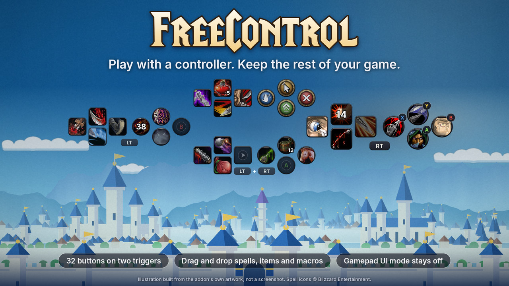
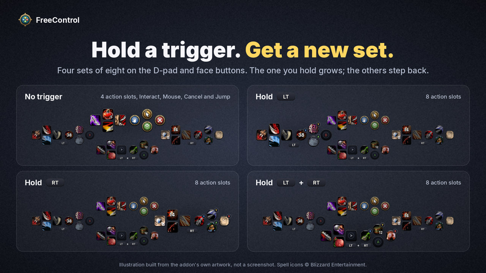
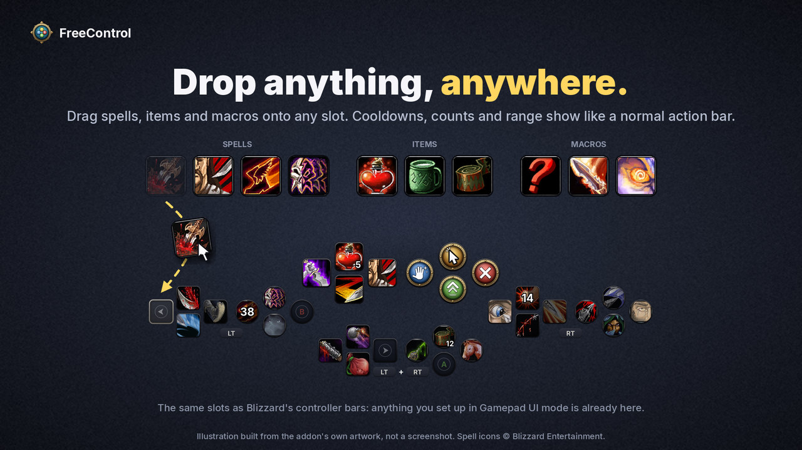
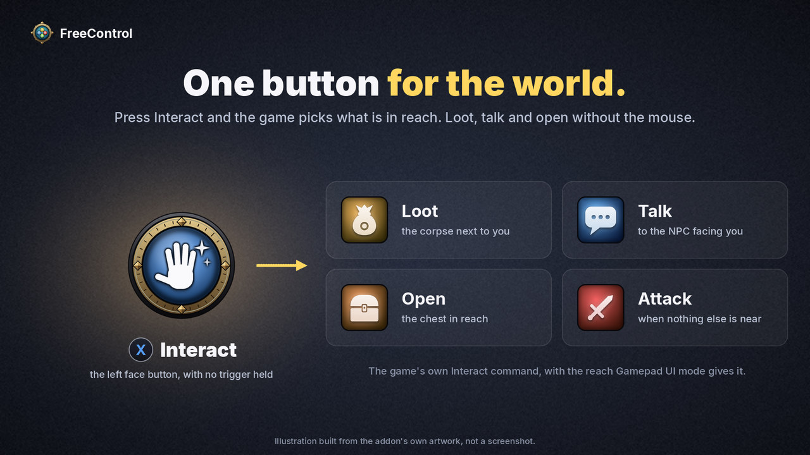
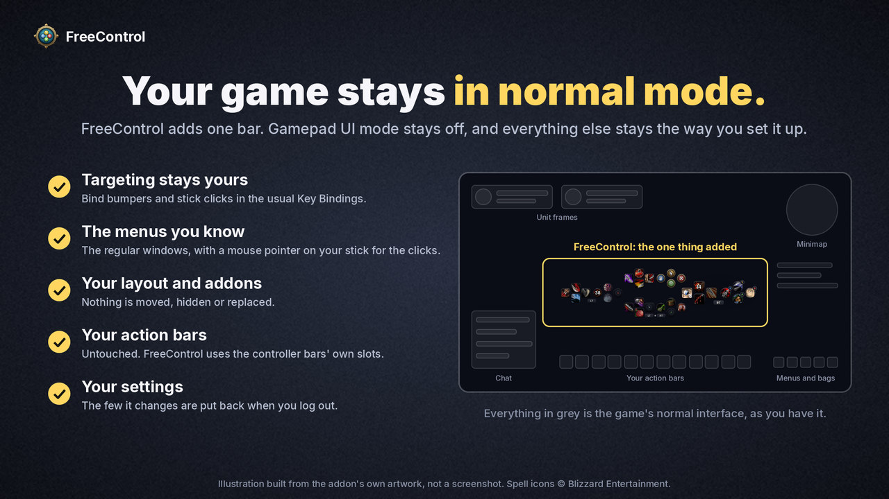
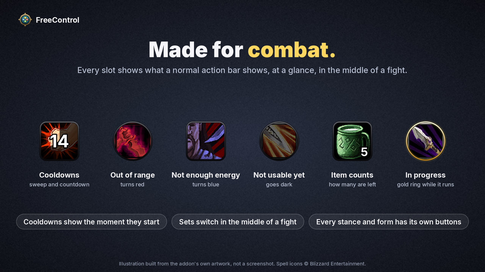
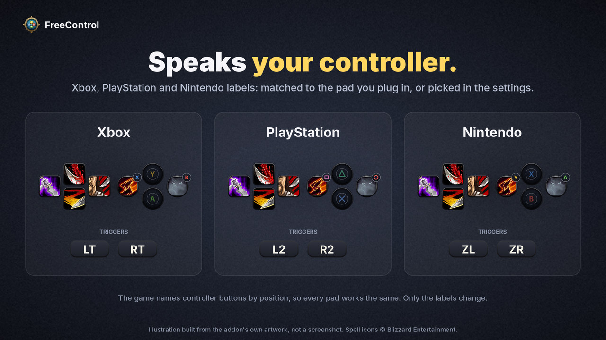
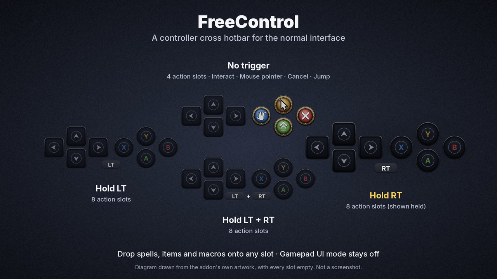
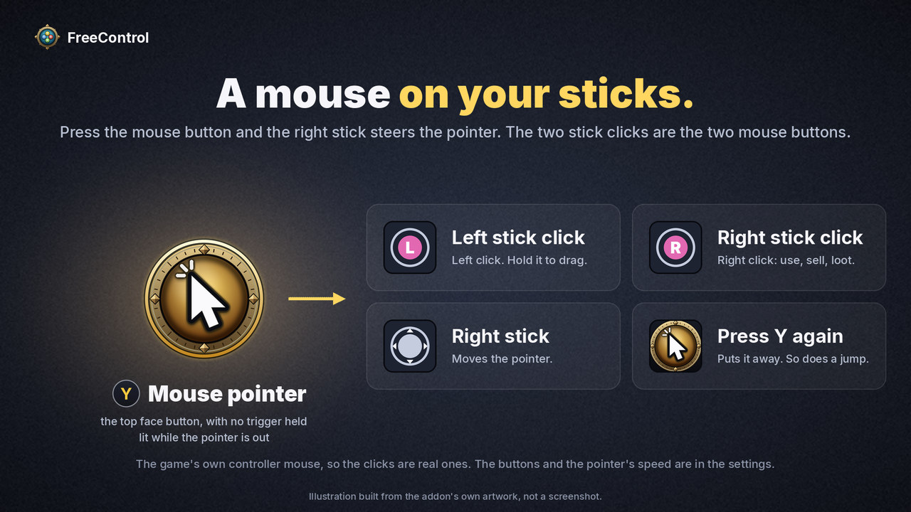

## Play Forever with a controller. Keep the rest of your game.

**FreeControl gives you the best part of Forever's controller mode, the trigger-driven cross hotbar, and leaves everything else exactly the way you like it.**

Forever's built-in Gamepad UI has a great idea at its heart: hold LT, RT or both, and your D-pad and face buttons become a whole new set of abilities. It is the layout console MMO players know from Final Fantasy XIV, and it feels fantastic on a controller. The catch is that switching Gamepad UI on also takes over your targeting, your menus and your whole interface layout.

FreeControl is that hotbar on its own. The game stays in normal mode. Your targeting stays yours. Your menus stay the ones you know. Pick up the controller and play.

## Why you will like it

### 32 buttons under your thumbs

Four sets of eight on the D-pad and face buttons: one with no trigger, one for LT, one for RT, one for both. The set you are holding grows and the others step back, so you always know where you are.

### Drop anything, anywhere

Drag spells, items and macros straight from your spellbook and bags onto any slot. FreeControl uses the same slots as Blizzard's controller bars, so whatever you already set up in Gamepad UI mode is waiting for you, and it does not rearrange the action bars you already have.

### One button for the world

Interact loots the corpse next to you, talks to the NPC in front of you, opens the chest, and attacks your target when there is nothing else to do.

### Your game stays in normal mode

Bumpers, stick clicks and every button FreeControl does not use are yours. Bind them in the normal Key Bindings screen, to whatever targeting you prefer. The menus are the ones you know, and nothing in your layout is moved or replaced.

### Made for combat

Every slot shows what a normal action bar shows: cooldowns with a countdown, item counts, range and out-of-mana colouring. Sets switch in the middle of a fight, the button sinks under your thumb, and its cooldown shows the moment it starts. An equipped item is ringed in the colour of its rarity.

### Every stance and form has its own buttons

Change stance or form and the bar changes with you, in the middle of a fight too. For most classes one set of eight swaps, as it does for a Rogue going into Stealth. A Druid gets more, because nothing a caster knows works in Cat or Bear form: the right set, the left set and the D-pad all change, 20 buttons for each form. The both-triggers set and the face buttons stay the same everywhere, which is where your shapeshifts, mount and trinkets go.

Already have Cat and Bear bars set up in the normal interface? They are on the left set and the D-pad the moment you shift. Any class can pick how much changes under *Stance sets* on the settings page.

### Speaks your controller

Xbox, PlayStation and Nintendo button labels, matched to the controller you plug in.

And two more things:

- **A mouse on your sticks.** Press Y and the right stick steers the mouse pointer, with the two stick clicks as its buttons. There is more on that below.
- **Leaves no mess.** Every game setting it touches is put back when you log out or switch it off.

## Up and running in a minute

1. Leave *Options > Gamepad > Enable Gamepad UI* **off**. FreeControl stands down while that mode is on.
2. Log in with your controller connected. The bar appears above your action bars.
3. Drag your spells onto the slots. Hold LT, RT or both to reach the other sets.
4. With no trigger held, the D-pad is four more action slots, X is Interact, Y brings out the mouse pointer, B is Cancel / game menu, and A is Jump. Click any of them on the bar to change what it does.

Type `/fc` for the settings, `/fc unlock` to drag the bar where you want it, and `/fc status` to see what the addon sees, which helps in a bug report.

## Mouse mode: a pointer on your sticks

Some things still want a mouse: a vendor, a quest window, your bags, dragging a spell onto the bar. Mouse mode gives you one without putting the controller down.

1. Press **Y** with no trigger held. The mouse pointer comes out, and the Y button on the bar lights up.
2. Steer the pointer with the **right stick**.
3. Click the **left stick** to left-click. Hold it while you steer to drag.
4. Click the **right stick** to right-click: use, sell, loot, talk.
5. Press Y again and the pointer is gone. Jumping puts it away too.

The triggers keep choosing your sets the whole time. The two click buttons and the pointer's speed are yours to change under *Mouse mode* on the settings page (`/fc`).

There is nothing to set up: FreeControl binds Y itself, the same way it binds Interact, and nothing is added to the game's Key Bindings screen. To have Y do something else, click it on the bar; any other no-trigger button can be the mouse button instead (choose *Mouse pointer on / off*).

## FreeControl, Gamepad UI mode or ConsolePort?

- **Gamepad UI mode**, built into Forever, is the game's whole controller interface: hotbar, menus, targeting and layout together. FreeControl is only the hotbar. It shows the same action slots and stands down whenever that mode is on, so you can go back and forth without setting anything up twice.
- **ConsolePort** is a complete controller interface addon, with its own bars, cursor, menus and targeting tools. If you want the whole game built around the gamepad, that is the one to look at. FreeControl is for players who want the stock interface plus a cross hotbar and nothing more. The two have not been tried together, and both bind the controller's buttons, so run one at a time.

## What it changes in your game

While it is active, FreeControl sets a few console variables, and puts your own values back at logout or when you switch it off:

- controller input is turned on, if it was off (this is not Gamepad UI mode);
- the Interact key behaviour is turned on, with the reach Gamepad UI mode uses;
- the left trigger stops standing in for Shift, which is the game's default and would keep it from registering as held;
- the game's two mouse-click buttons for its stick pointer are set to the stick clicks (the game starts with RT and RB, and RT is a hotbar trigger);
- the game's option that pins that pointer to the middle of the screen is switched off, if something had switched it on.

It binds the D-pad, the face buttons and the triggers with override bindings. Those sit on top of your saved key bindings without changing them.

## Good to know

- Mouse mode is the game's own stick pointer, so the clicks are real mouse clicks. A click button has to be a single button: a trigger combination cannot be one.
- Spell flyouts (one slot holding a group of spells) open below the button and need the mouse pointer to choose from. Put the individual spells on the bar instead.
- A Druid's left set and D-pad keep their form actions in the slots of the game's own action bar for that form, so what you drop on them in a form shows on that bar as well.
- There is no vehicle or possess bar yet. Use the game's own bar for those.
- Triggers are hold-to-select. There is no tap-to-toggle yet.

## Requirements

World of Warcraft: Forever and a controller the game recognises. No libraries or other addons needed.

The pictures on this page are illustrations built from the addon's own artwork, not screenshots. The spell icons in them are Blizzard's, and the title lettering is LifeCraft, a typeface by Eliot Truelove.

## Why I made this

I've been using a controller with WoW for a few years. I got used to ConsolePort but never loved not just having my regular old interface. When Blizzard came out with their GamePad support with Forever, I loved the HotBar approach, but ... sorta hated every thing else.

So I made this for myself.

I hope you like it too.

\- Sky

## Feedback

Found a bug or have an idea? The issue tracker and the source are on GitHub: [github.com/skytruax/FreeControl](https://github.com/skytruax/FreeControl)
